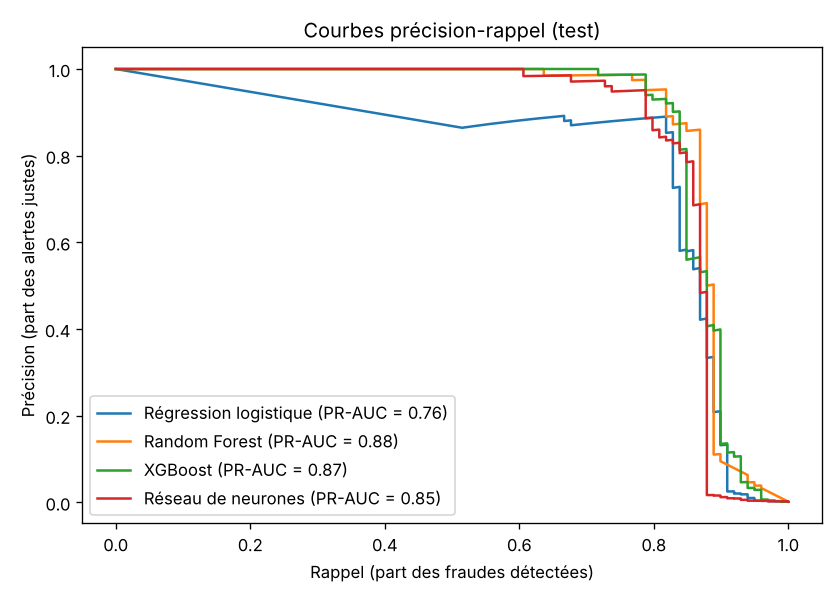
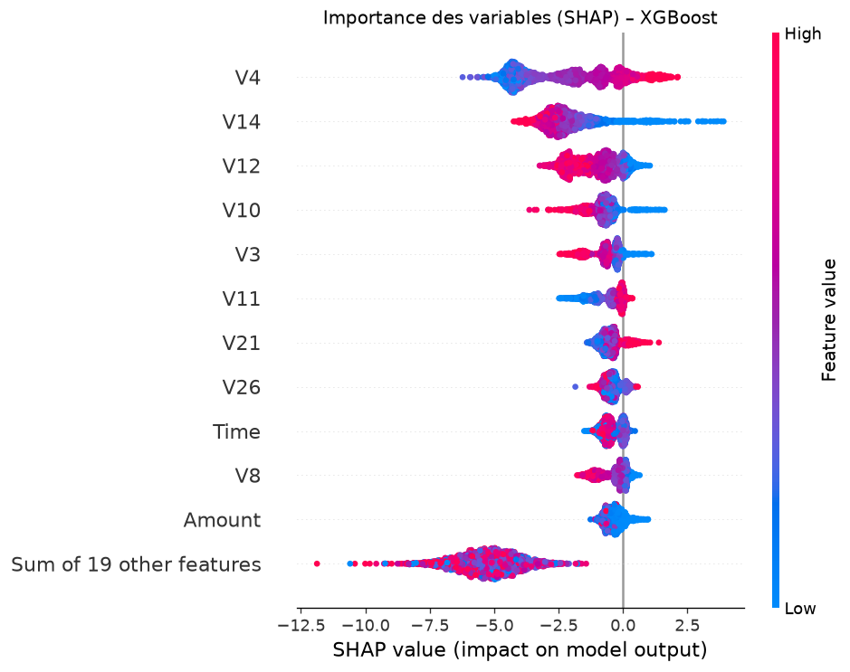

# Détection de fraude à la carte bancaire – Benchmark de modèles de Machine Learning

🇫🇷 [Français](#-français) · 🇬🇧 [English](#-english)



---

## 🇫🇷 Français

### Objectif
Comparer des modèles de Machine Learning (**Random Forest, XGBoost, réseau de neurones**) à un modèle classique, la **régression logistique**, pour détecter les fraudes à la carte bancaire. Puis rendre les modèles **explicables (SHAP)** et traduire les résultats en **euros**.

### Données
[Credit Card Fraud Detection](https://www.kaggle.com/datasets/mlg-ulb/creditcardfraud) (ULB / Worldline) : 284 807 transactions européennes, dont **492 fraudes (0,17 %)**. Les variables `V1`–`V28` sont anonymisées (ACP), seules `Time` et `Amount` sont en clair. Le fichier CSV n'est pas inclus dans ce dépôt : il faut le télécharger sur Kaggle.

### Démarche
1. **Exploration :** contrôle qualité, déséquilibre des classes, montants des fraudes.
2. **Découpage stratifié** : entraînement 60 % / validation 20 % / test 20 %.
3. **Quatre modèles**, avec gestion du déséquilibre (`class_weight`, `scale_pos_weight`).
4. **Choix du seuil** de décision sur la validation (maximisation du F1).
5. **Évaluation sur le test** : AUC-ROC, **PR-AUC**, précision, rappel, F1. L'accuracy n'est pas utilisée, car elle n'a pas de sens avec 0,17 % de fraudes.
6. **Explicabilité** avec SHAP (importance globale et explication d'une transaction).
7. **Impact financier** : gain net = pertes évitées − coût des alertes, avec un seuil optimisé sur le coût.

### Résultats (jeu de test, 99 fraudes)

| Modèle | AUC-ROC | PR-AUC | Précision | Rappel | F1 |
|---|---|---|---|---|---|
| Régression logistique | 0,966 | 0,758 | 0,886 | 0,788 | 0,834 |
| Random Forest | 0,977 | **0,875** | 0,931 | 0,818 | **0,871** |
| XGBoost | 0,977 | 0,872 | 0,931 | 0,818 | **0,871** |
| Réseau de neurones | 0,958 | 0,854 | 0,844 | 0,818 | 0,831 |

### Ce que j'en retiens
- **XGBoost et Random Forest** classent bien mieux les transactions à risque que la régression logistique (PR-AUC 0,87–0,88 contre 0,76), avec moins de fausses alertes.
- **En euros, l'écart est beaucoup plus faible** et dépend du seuil et du coût d'une alerte : la régression logistique a détecté quelques fraudes de montant élevé. Un meilleur score statistique ne garantit pas un meilleur gain financier, d'où l'importance de construire les hypothèses de coût avec le métier.
- **SHAP** montre que quelques variables (`V4`, `V14`, `V12`, `V10`) portent l'essentiel des décisions.



### Limites
Découpage aléatoire (un découpage temporel serait plus réaliste), variables anonymisées, petit nombre de fraudes en test.

### Outils
Python · pandas · scikit-learn · XGBoost · SHAP · Matplotlib

### Lancer le projet
```bash
pip install -r requirements.txt
# placer creditcard.csv (Kaggle) dans le dossier
jupyter notebook fraud_detection_benchmark.ipynb
```

---

## 🇬🇧 English

### Goal
Benchmark Machine Learning models (**Random Forest, XGBoost, neural network**) against a classic **logistic regression** for credit card fraud detection, make them **explainable with SHAP**, and translate the results into **money**.

### Data
[Credit Card Fraud Detection](https://www.kaggle.com/datasets/mlg-ulb/creditcardfraud): 284,807 European card transactions, **492 frauds (0.17%)**. Features `V1`–`V28` are PCA-anonymised. The CSV is not included; download it from Kaggle.

### Method
Stratified 60/20/20 split · class imbalance handling · decision threshold tuned on validation · evaluation with ROC-AUC, **PR-AUC**, precision, recall, F1 (no accuracy) · SHAP explanations · financial impact (avoided losses minus alert handling cost), with a cost-optimised threshold.

### Key findings
- Tree-based models (**XGBoost, Random Forest**) rank risky transactions much better than logistic regression (PR-AUC 0.87–0.88 vs 0.76) with fewer false alerts.
- **In euros the gap is much smaller** and depends on the threshold and the cost of an alert: a better statistical score does not guarantee a better financial outcome.
- SHAP shows that a few features (`V4`, `V14`, `V12`, `V10`) drive most decisions.

**Author:** Sezen Nisa Dikmen
